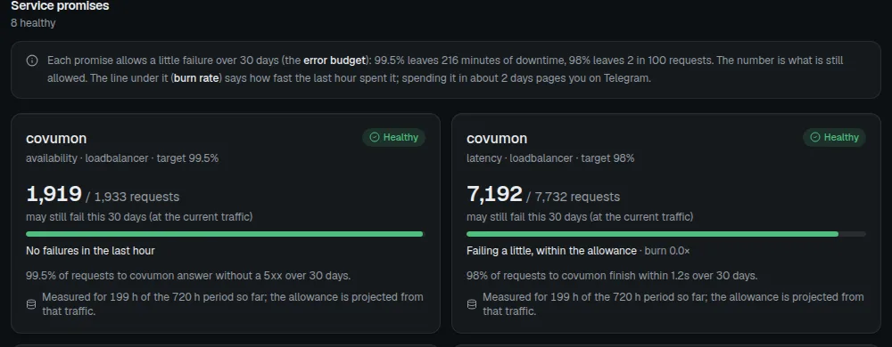
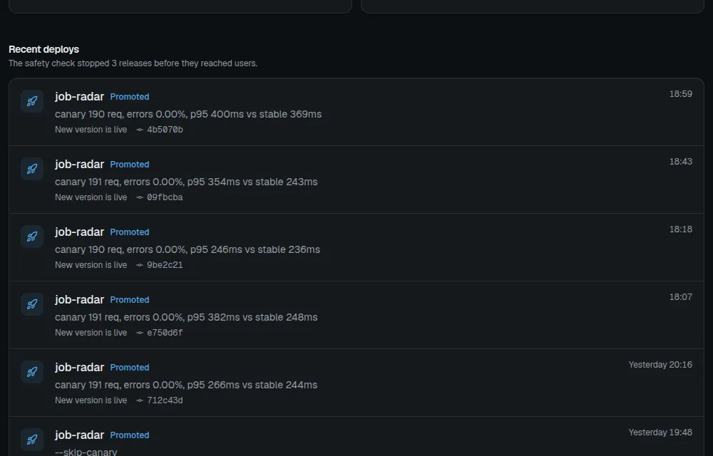

# Fleet Pulse

Reliability layer for a five-node self-hosted fleet: SLOs with error budgets, canary deploys with
automatic rollback, and incidents that open, close and draft their own postmortem.

It is built on the monitoring stack that already runs on server-3 (Prometheus, Alertmanager, Loki,
blackbox exporter) and only adds what that stack lacks.

This repository is a public copy of the code that runs my fleet. The fleet-specific configuration (the real list of
probed apps, host addresses, account IDs) is replaced with examples; everything else is the code in production.

| SLOs with error budgets | Deploys through the canary |
|---|---|
|  |  |

## Parts

| Part | Where | What it does |
|---|---|---|
| `slo/*.yaml` + `generate-slo-rules.sh` | server-3 | SLO specs. Sloth turns them into recording rules and multiwindow burn-rate alerts in `~/monitoring/prometheus/rules/slo-*.yml`. |
| `deploy/` (`fleet-pulse-deploy`) | installed on the node that runs the app (oracle for Job Radar) | Canary controller for Docker Compose apps behind Traefik. |
| `app/` (Fleet Pulse service) | server-3, `pulse.docaohieu.com`, tailnet-only | The one dashboard: open incidents, every app up/down, SLOs, deploys, past incidents. Receives Alertmanager webhooks and deploy events, keeps incidents in SQLite, drafts postmortems. UI in `app/ui` (Vite + React, static build). |
| `watchdog/` | Cloudflare Worker `fleet-watchdog`, `watchdog.docaohieu.com`, no page | Dead man's switch: Telegram when the Alertmanager heartbeat stops for 10 minutes. |

## SLOs

- Apps with real traffic (covumon) or a Traefik route on the fleet: request-based.
  A 5xx is a failed request; covumon also has a latency SLO (98% under 1.2 s, set just under the measured baseline).
- job-radar: probe-based on `/health`. Only the owner uses it; it is the sample SLO and the app canary deploys run
  on. (Request-based saw 0% errors while it was fully down: Traefik answers 404 once the container's route is gone.)
- Owner products off the fleet (IELTS Pocket, Repotray relay and site): black-box probes
  from server-3. Nothing is installed on those hosts.
- Objective 99.5% over 30 days. Prometheus keeps 35 days (cap 12 GB) so the window is always full.
- Alerts: page (Telegram) when the budget burns fast (Sloth defaults: 14.4x over 1h/5m, 6x over 6h/30m),
  ticket (email) for slow burns.
- The page shows the budget in units a person can picture: minutes of downtime still allowed for probe-based SLOs
  (99.5% of 30 days = 216 min), failed requests still allowed for request-based ones (projected from the traffic so
  far), and the burn rate as "at this pace, used up in ~N days".

Change an SLO: edit `slo/<app>.yaml`, run `./generate-slo-rules.sh` (validates with promtool, reloads Prometheus).

## Canary deploy

```
fleet-pulse-deploy job-radar            # build, canary at 10% for 10 min, promote or roll back
fleet-pulse-deploy job-radar --src DIR  # build from another source tree
fleet-pulse-deploy job-radar --skip-canary
fleet-pulse-deploy job-radar --abort    # remove a leftover canary
```

1. Refuses when the new image adds or edits a migration (compared by content hash): canary and stable share one
   database, so a schema change could not be rolled back. Ship it backward-compatible and use `--skip-canary`,
   which still checks the new version through Traefik and restores the previous one if it fails.
2. Builds the image, starts a canary container, waits for `/health` on the container and then through Traefik on
   its own host name (the path real traffic takes).
3. Writes a Traefik file-provider route with a weighted service (stable 90, canary 10) at a higher priority than
   the app's own router. Synthetic read-only traffic (3 req/s, four workers sharing one pacing clock) runs
   meanwhile, because a personal app has too few real requests to judge. The minimum sample is derived from
   that rate.
4. Every 30 s compares the canary with stable over the same window from Traefik metrics: failures (5xx and 499,
   the latter being a canary Traefik cannot reach) with a 1% ceiling or 2x stable, so a shared outage is not
   blamed on the new version, and p95 at most 1.5x stable + 50 ms. A canary failing over half of 20+ requests
   leaves at once; a missing latency histogram fails the final check instead of skipping it.
5. Outcomes, each recorded locally and in Fleet Pulse:
   - `rolled_back`: judged worse, split and canary removed, production never changed.
   - `aborted`: could not be judged (never healthy, not routable, controller stopped or failed); same cleanup.
     SIGTERM and SIGHUP (an ssh session dropping mid-run) run the same cleanup as Ctrl-C.
   - `promoted`: traffic moves 100% to the canary, stable is recreated on the new image and checked through
     Traefik, then the split goes. The previous image is kept as `:previous`.
   - `promote_failed`: the switch failed and `:previous` was restored; if even that failed, the canary keeps
     serving 100% and the reason says to fix stable by hand.
6. Only the five newest canary-built images are kept.

Why not Flagger or Argo Rollouts: both need Kubernetes; this fleet runs Compose, PM2 and Workers.

## Incidents

Alertmanager sends every cluster alert to Fleet Pulse (`continue: true`, the normal email and Telegram routes still
run). A critical alert or an SLO burn opens an incident keyed by app (or instance); later alerts for the same key
join its timeline.

- Alertmanager delivers at least once and may send two groups for one app at the same moment, so one lock
  serialises webhooks, a unique index allows one open incident per key, each alert's state is tracked so repeats
  and late or out-of-order notifications change nothing, and a whole payload is validated before anything is
  written.
- Every 5 minutes a sweep compares open alerts with Alertmanager's active list and resolves the ones whose
  "resolved" notification was lost.
- Promoted deploys of that app in the two hours before the start go on the timeline as first suspects.
- When the last alert resolves, the incident closes with a blameless postmortem draft. It counts from when the
  failure began (alert time minus the rule's `for:`), and includes the share of the 30-day budget burned and a
  sample of that app's failed requests from the Traefik access log in Loki. Root cause and action items are left
  for the owner.
- While an incident is open the owner can write down its cause (`POST /api/incidents/<id>/ack`). It turns grey on
  the page, the note goes on the timeline and into the postmortem, and any new alert joining it makes it red again.

## Security

- Tailnet-only behind Traefik's allow-list. Reads need no login (one owner).
- Writes (`/api/alertmanager`, `/api/deploys`, `/api/incidents/<id>/ack`) need a bearer token (`FLEET_PULSE_TOKEN` in `app/.env`), compared in
  constant time, because every tailnet device can reach the service.
- Label values are checked against `[A-Za-z0-9_.:-]` before they go into PromQL or LogQL.
- The container runs as a non-root user on a read-only filesystem with all capabilities dropped.

## Every app, and who watches the watchers

- All 31 apps are probed every minute by the blackbox `apps` job on server-3 (inside the tailnet). Each target
  carries `name`, `app_group`, `host`, `link` and its module (`app_ok`, `app_gated` accepts 401/403,
  `app_tailnet` accepts 401 only, so Traefik's 403 counts as down). `page="no"` shows an app without alerting.
  This replaced status.docaohieu.com (removed 24 Oct 2026).
- Prometheus, Alertmanager and Fleet Pulse all run on server-3, so nothing there can report server-3 dying.
  Prometheus fires an always-on `Watchdog` alert (`rules/watchdog.yml`); Alertmanager sends it every 5 minutes
  to `watchdog.docaohieu.com/heartbeat` (bearer token). The Worker sends one Telegram message to the critical
  channel after 10 minutes of silence; no recovery message, like that channel. Drill 24 Oct: Alertmanager
  stopped 18:44, Telegram ~18:53.
- Deploy the watchdog from server-1: `set -a; . ~/.config/cloudflare/workers-deploy.env; set +a; npx wrangler deploy`
  in `watchdog/`. Secrets: `TELEGRAM_BOT_TOKEN`, `TELEGRAM_CHAT_ID`, `HEARTBEAT_TOKEN` (same value as the
  heartbeat receiver credentials in alertmanager.yml).

## Data layer changes made for this

- Traefik metrics enabled on oracle (entrypoint `metrics`, tailnet address :8082), finer latency buckets.
- Traefik access logs of all five nodes shipped to Loki (`job="traefik-access"`); lines older than
  15 minutes are dropped so a promtail restart never replays history.
- Probes for the owner's products (`group="product"` in the `blackbox-http` job).

## Develop

```
cd deploy && python3 -m unittest discover -s tests -t .   # controller, including every failure path
cd app && python3 -m unittest discover -s tests -t .      # incidents, HTTP handler
node --test watchdog/test/
cd app/ui && npm ci && npm run build
cd app && docker compose up -d --build                    # on server-3; needs app/.env (see .env.example)
```

GitHub Actions runs all of the above on every push. `ops/` mirrors the fleet configuration this relies on
(Prometheus jobs and rules, blackbox modules, Alertmanager routes, promtail), with tokens redacted.

## License

MIT, see [LICENSE](LICENSE).
